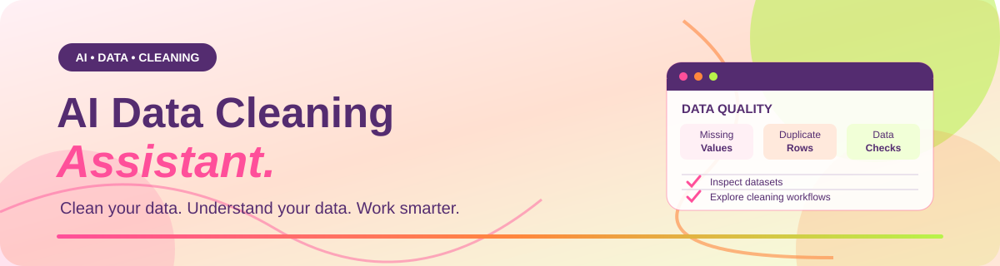

# AI Data Cleaning Assistant

  

### Clean your data. Understand your data. Work smarter.

An AI-assisted data-cleaning application built with Google AI Studio.

---

## Overview

AI Data Cleaning Assistant is a project designed to make dataset inspection and data-cleaning workflows easier through an interactive application interface.

The project explores how AI-assisted development can help turn a practical data-processing idea into a usable software application.

## What this project explores

- Dataset upload and inspection workflows.
- Identifying common data-quality issues.
- Making data-cleaning tasks easier to understand.
- An interactive interface for working with datasets.
- Building and refining an application with Google AI Studio.

*The exact supported operations depend on the current implementation. Refer to the application itself for available features.*

## Built with

- Google AI Studio
- The programming languages and libraries used by the generated application

## Getting started

**Try the application:** Add your deployed application URL here once it is available.

**Source code:** Browse this repository to explore the implementation.

To run the project locally, follow the setup instructions for the actual framework and dependencies included in this repository.

## Why I built it

I am developing practical AI engineering skills by turning ideas into working applications, experimenting with user interfaces, and exploring ways to make everyday data workflows more accessible.

## Future improvements

- Refine the user experience.
- Expand supported data-cleaning workflows.
- Improve data-quality summaries and reporting.
- Document supported file formats and operations.

## Author

**Maham Yasir**

[GitHub Profile](https://github.com/MahamYasir-ai)
